# Hi, I'm Aman 👋

**GTM engineer for B2B tech with high ACV and long sales cycles · Founder & CEO of [Clarafold](https://clarafold.com)**

Everyone posts the trailer: pipeline, MQLs, "millions in opportunities". This GitHub is where I show the film — the agent skills, workflows and automations behind the go-to-market systems I build for hard B2B markets: small markets, buying committees, long cycles and buyers who trust slowly.

I was a filmmaker before I was a marketer. A film only works when every scene earns the next one, and GTM is the same: the lead magnet earns the meeting, the meeting earns the pilot, the pilot earns the signature. I build the system that connects those scenes.

> **Building got cheap. Buying got harder.** Agents do the repetitive work; people make the calls.

---

### 🛠 What I'm building

- **GTM agent skills** — repeatable go-to-market workflows packaged so your own AI (Claude Code and others) can install and run them
- **Agentic outbound & ABM** — research → enrichment → personalization → sequencing, with a human signing off everything that ships
- **GTM intelligence** — turning engagement data into *who* engaged, *how deeply*, and *whether it repeated*
- **AI Search Visibility** — getting B2B brands cited by ChatGPT, Claude, Perplexity and Google AI

### 🎬 The scenes, in numbers

- **~6 months from stranger to signature** on one deal, in a market where 16 months is normal
- **78 downloads in 49 days** from one £0 compliance checklist, with 4.2% booking a meeting ([case study](https://clarafold.com/case-studies/compliance-lead-magnet-pipeline))
- **61.6% DM reply rate** — 77 replies from 125 comment-first LinkedIn DMs ([case study](https://clarafold.com/case-studies/comment-first-linkedin-outreach))
- **60% vs 29% opens** — same email, opted-in audience vs broadcast ([case study](https://clarafold.com/case-studies/intent-audience-vs-broadcast))

### 📂 Start here

| Repo | What's inside |
|---|---|
| 🧠 **[clarafold-gtm-skills](https://github.com/cyberanon1111/clarafold-gtm-skills)** | 5 free GTM workflows as agent skills for Claude, Claude Code, Codex and Cursor: ICP research, outbound personalization, LinkedIn content research, lead enrichment, account prioritization |
| 🏢 **[clarafold](https://github.com/cyberanon1111/clarafold)** | The Clarafold portfolio: services and pricing, 15 case studies with real numbers, how an engagement works, 25 insights |
| ⭐ **[awesome-ai-gtm](https://github.com/cyberanon1111/awesome-ai-gtm)** | A curated list of 30+ open-source repos for AI-powered B2B go-to-market: skills, MCP, automation, research, RevOps, email |

### 🧩 What Clarafold does

**[Diagnosis Sprint](https://clarafold.com/diagnosis-sprint)** (10 days, fixed fee) → then **[LinkedIn Growth Engine](https://clarafold.com/linkedin-growth)** · **[Automated Outbound](https://clarafold.com/services/outbound)** · **[RevOps](https://clarafold.com/services/revops)** · **[ABM Programs](https://clarafold.com/services/abm)** · **[GTM Strategy](https://clarafold.com/services/gtm-strategy)** · **[AI Search Visibility](https://clarafold.com/ai-search-visibility)**

→ [All 15 case studies](https://clarafold.com/customers) · [Free workflows](https://clarafold.com/workflows) · [Insights](https://clarafold.com/insights)

### 🧰 Toolkit

`GTM Engineering` · `Claude Code` · `Agent Skills` · `MCP` · `n8n` · `APIs & automation` · `CRM / RevOps` · `ABM` · `Lead magnets & nurture` · `HTML / JS`

### ✍️ Writing

<!-- WRITING:START -->

43 articles on [clarafold.com/insights](https://clarafold.com/insights). Practical, sourced and written for teams selling into hard B2B markets.

**Latest**

- [Writing for technical buyers: proof over claims](https://clarafold.com/insights/content-for-technical-buyers) · `Content`
- [Win-loss interviews: the cheapest GTM research you are not doing](https://clarafold.com/insights/win-loss-interviews) · `GTM`
- [The one-page account plan: what to write before the first touch](https://clarafold.com/insights/one-page-account-plan) · `ABM`
- [Signal-based outbound: which triggers are worth acting on](https://clarafold.com/insights/signal-based-outbound-triggers) · `Outbound`
- [One expert interview, a month of B2B content](https://clarafold.com/insights/one-expert-interview-content) · `Content`

**All articles by topic**

<b>GTM</b> · 7

- [Win-loss interviews: the cheapest GTM research you are not doing](https://clarafold.com/insights/win-loss-interviews)
- [Build your ICP from closed-won deals, not personas](https://clarafold.com/insights/icp-from-closed-won)
- [A 90-day GTM plan for seed to Series B companies](https://clarafold.com/insights/90-day-gtm-plan)
- [GTM agency or first marketing hire? How seed to Series B teams should choose](https://clarafold.com/insights/gtm-agency-or-first-marketing-hire)
- [Vertical SaaS positioning: sell the workflow, not the platform](https://clarafold.com/insights/vertical-saas-positioning)
- [Diagnose before you automate: where B2B GTM actually gets stuck](https://clarafold.com/insights/diagnose-before-you-automate)
- [Why more marketing activity doesn't necessarily create more pipeline](https://clarafold.com/insights/marketing-activity-pipeline)

<b>ABM</b> · 8

- [The one-page account plan: what to write before the first touch](https://clarafold.com/insights/one-page-account-plan)
- [How to measure ABM when deals take nine months](https://clarafold.com/insights/measuring-abm-long-sales-cycles)
- [ABM tiers without a platform: one-to-one, one-to-few, one-to-many](https://clarafold.com/insights/abm-tiers-without-a-platform)
- [ABM or outbound first? A decision rule for complex B2B](https://clarafold.com/insights/abm-or-outbound-first)
- [Map the buying committee before you run ABM](https://clarafold.com/insights/map-the-buying-committee)
- [Intent beats list size: why small segments outperform big sends](https://clarafold.com/insights/intent-beats-list-size)
- [Competitive account intelligence: grade your evidence](https://clarafold.com/insights/grade-your-evidence)
- [ABM starts with account selection](https://clarafold.com/insights/abm-account-selection)

<b>Outbound</b> · 6

- [Signal-based outbound: which triggers are worth acting on](https://clarafold.com/insights/signal-based-outbound-triggers)
- [How to write a cold email opening line that earns a reply](https://clarafold.com/insights/cold-email-first-line)
- [How many follow-ups? Designing an email and LinkedIn cadence](https://clarafold.com/insights/outbound-follow-up-cadence)
- [Cold email deliverability: the setup before the sequence](https://clarafold.com/insights/cold-email-deliverability-setup)
- [Lead magnets should qualify buyers, not just capture emails](https://clarafold.com/insights/lead-magnets-that-qualify)
- [Outbound is a system, not a sequence](https://clarafold.com/insights/outbound-is-a-system)

<b>RevOps</b> · 6

- [Define pipeline stages by what the buyer did, not the seller](https://clarafold.com/insights/pipeline-stages-buyer-actions)
- [CRM hygiene before automation: the fields that actually matter](https://clarafold.com/insights/crm-hygiene-before-automation)
- [Attribution for long B2B sales cycles: ask, then track](https://clarafold.com/insights/attribution-for-long-sales-cycles)
- [Lead scoring sales will trust: separate fit from intent](https://clarafold.com/insights/lead-scoring-fit-and-intent)
- [The marketing metrics that quietly lie](https://clarafold.com/insights/metrics-that-lie)
- [RevOps is the infrastructure behind GTM](https://clarafold.com/insights/revops-infrastructure)

<b>Content</b> · 7

- [Writing for technical buyers: proof over claims](https://clarafold.com/insights/content-for-technical-buyers)
- [One expert interview, a month of B2B content](https://clarafold.com/insights/one-expert-interview-content)
- [Comment before you post: growing on LinkedIn in a niche B2B market](https://clarafold.com/insights/comment-before-you-post)
- [Build an owned audience: why B2B teams need a newsletter before another channel](https://clarafold.com/insights/build-an-owned-audience)
- [Distribution before content: go where attention already is](https://clarafold.com/insights/distribution-before-content)
- [Community-led GTM for technical buyers](https://clarafold.com/insights/community-led-gtm-technical-buyers)
- [Founder-led content is becoming a GTM system](https://clarafold.com/insights/founder-led-content)

<b>AI</b> · 9

- [Measuring AI search visibility: what to track every month](https://clarafold.com/insights/measuring-ai-search-visibility)
- [Before you buy another AI GTM tool: five questions](https://clarafold.com/insights/before-you-buy-an-ai-gtm-tool)
- [AI account research that cites its sources](https://clarafold.com/insights/ai-account-research-with-sources)
- [llms.txt for B2B websites: what it does, what it doesn't, and how to write one](https://clarafold.com/insights/llms-txt-for-b2b)
- [Test AI GTM workflows like software before anyone trusts the output](https://clarafold.com/insights/test-ai-workflows-like-software)
- [Is your website invisible to AI assistants?](https://clarafold.com/insights/invisible-to-ai-search)
- [Human-in-the-loop agents: why every outbound message should be approved](https://clarafold.com/insights/human-in-the-loop-agents)
- [Agent skills: how to give your AI your GTM playbook](https://clarafold.com/insights/agent-skills-for-gtm)
- [What AI changes about B2B GTM](https://clarafold.com/insights/what-ai-changes)

<!-- WRITING:END -->

Also on Medium: [From Marketing Activity to GTM Intelligence](https://medium.com/@aciddun/from-marketing-activity-to-gtm-intelligence-how-i-built-a-behavioral-intelligence-system-using-3408d9efc3a7), building a GTM intelligence system in ~1.5 hours.

---

### 🤝 Let's talk

If you work on GTM in a niche or technical market, connect or DM me. I read and reply to every message.

